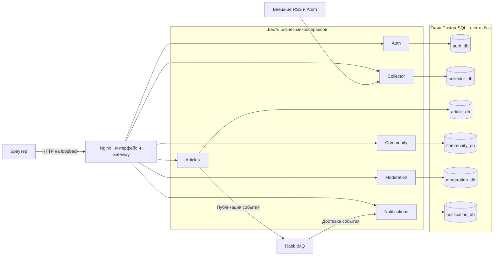

# Общая архитектура

Шесть приложений FastAPI собираются в отдельные образы. Браузер обращается к единому Nginx Gateway, который также раздаёт статический интерфейс. PostgreSQL и RabbitMQ работают отдельными контейнерами.

[Compose](../../compose.yaml) · [Взаимодействие](communication.md)
