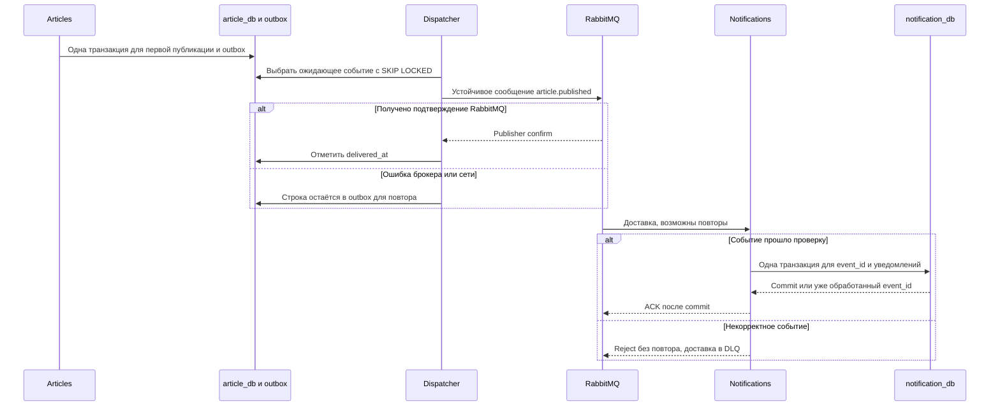

# Событие первой публикации

Уникальность `event_id` устраняет повторную обработку. При ошибке транзакции потребитель допускает ограниченное число повторов RabbitMQ. [Outbox](../../services/articles/app/outbox.py) · [Consumer](../../services/notifications/app/consumer.py) · [Топология](../../services/runtime/cybernews_runtime/broker.py)
