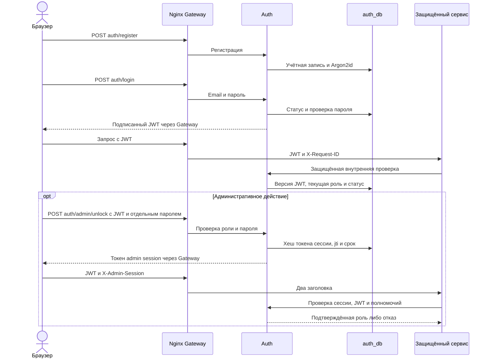

# Авторизация

Профиль и другие собственные операции Auth проверяются локально в Auth. Смена пароля, роли или статуса отзывает ранее выданный доступ. [Контракт Auth и Moderation](../../docs/AUTH_MODERATION_API.md)
