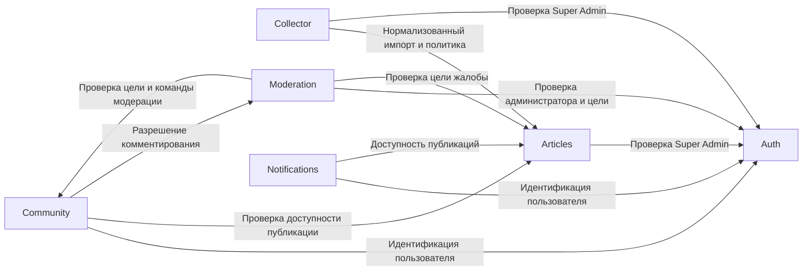
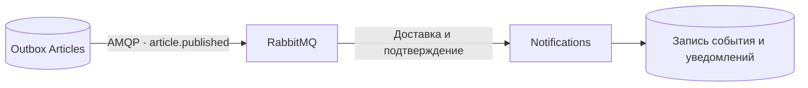

# Межсервисное взаимодействие

Клиентский доступ идёт через Gateway. Сервисы обращаются друг к другу по DNS-именам в сети Compose.

[Внутренние REST-клиенты](../../services/runtime/cybernews_runtime/service_client.py) · [Доставка события](article-events.md)
