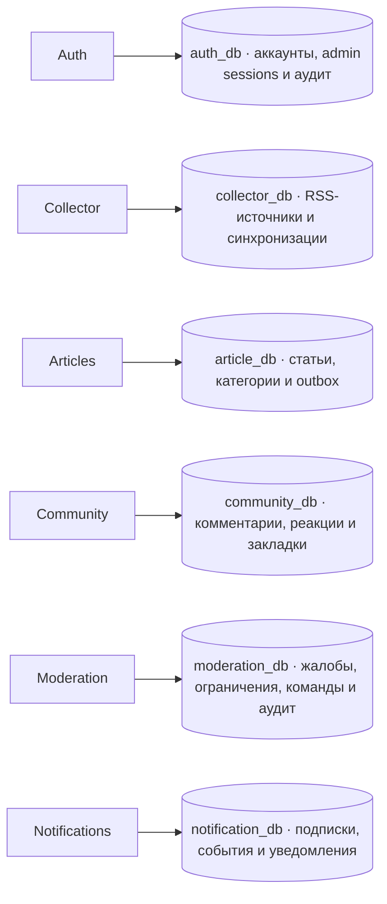

# Владельцы данных

Стрелка указывает единственную базу приложения. Идентификаторы из других сервисов передаются по контрактам HTTP или в событиях. Внешние ключи SQL связывают таблицы только внутри базы владельца.

Роль каждого сервиса владеет только своей базой. Для подключения к PostgreSQL применяются отдельные учётные данные. [Инициализация PostgreSQL](../../infrastructure/postgres/10-initialize.sh) · [Проверка доступа](../../tests/postgres-smoke.sh)
